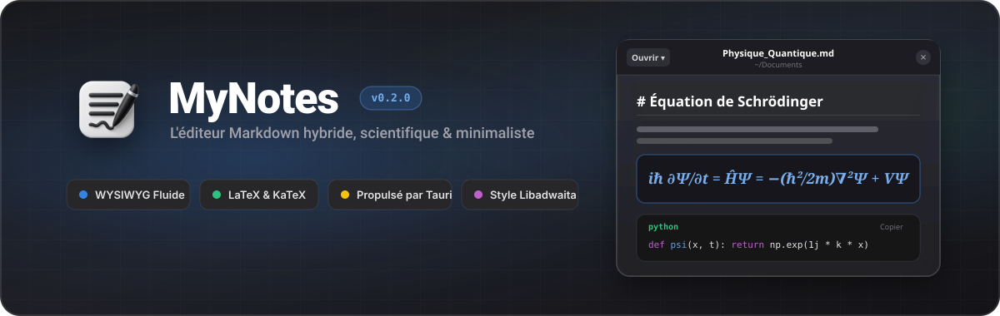

<div align="center">

<!-- BANNIÈRE VECTORIELLE SVG (AVEC LE VRAI LOGO MYNOTES) -->


<div align="center">
  <table border="0" style="border: none; border-collapse: collapse; background: transparent;">
    <tr style="border: none;">
      <td valign="middle" style="border: none;">
        
      </td>
      <td valign="middle" style="border: none;">
        <h1>MyNotes</h1>
      </td>
    </tr>
  </table>
</div>

### **L'éditeur Markdown hybride (WYSIWYG), scientifique et minimaliste.**
*Inspiré par l'élégance de GNOME Libadwaita et la fluidité de Typora.*

[](https://github.com/mamboulietjophemmanuel-cmyk/MyNotes)
[](#🚀-installation--développement)
[](https://tauri.app/)
[](https://react.dev/)
[](https://www.typescriptlang.org/)
[](LICENSE)

<br />

[**⬇️ Télécharger pour Windows**](#🚀-installation--développement) · [**✨ Découvrir les fonctionnalités**](#-fonctionnalités-principales) · [**⌨️ Raccourcis clavier**](#️-raccourcis-clavier)

<sub>💡 *Installateur natif disponible pour **Windows** (`.exe` / `.msi`). Les versions pré-compilées pour **Linux** et **macOS** arrivent bientôt (déjà [compilables depuis les sources](#🚀-installation--développement)).*</sub>

<br />

<!-- EMPLACEMENT DU GIF / CAPTURE PRINCIPALE DE L'INTERFACE -->
> 📸 **[Aperçu principal de MyNotes — *Visuel à venir*]**
> *(Capture d'écran en mode Clair / Sombre montrant le rendu mathématique, le code et les tableaux)*

</div>

---

## 💡 Pourquoi MyNotes ?

Les éditeurs Markdown classiques vous obligent souvent à choisir entre **deux extrêmes** : un écran divisé encombrant (code à gauche, aperçu à droite) ou une usine à gaz complexe.

**MyNotes** réunit le meilleur des deux mondes dans une application de bureau ultra-légère propulsée par **Tauri** :
- **Écriture sans distraction (Live Rendering)** : Tapez en Markdown, voyez le résultat mis en forme instantanément. Cliquez sur n'importe quel bloc pour modifier sa syntaxe brute exactement là où se trouve votre curseur.
- **Pensé pour les sciences et la tech** : Éditeur d'équations **LaTeX (KaTeX)** avec aperçu en direct, générateur de tableaux interactif et blocs de code avec copie en un clic.
- **Design Libadwaita natif** : Une interface épurée, sans bordures superflues, avec gestion multi-onglets intelligente et thèmes Clair / Sombre automatiques.

---

## ✨ Fonctionnalités principales

### 1. ✍️ Éditeur Hybride « Live-Preview » (Style Typora)
* **Rendu bloc par bloc instantané** : Les titres (`#` à `######`), listes, citations et séparateurs prennent forme dès que vous validez ou quittez le bloc.
* **Positionnement intelligent du curseur** : Cliquez sur n'importe quel mot d'un paragraphe rendu pour basculer en mode édition avec le curseur placé **exactement** sur la lettre cliquée.
* **Mise en forme en ligne** : **gras** (`**`), *italique* (`*`), ~~barré~~ (`~~`), `code` (`` ` ``), liens et formules `$...$` sont rendus dans le texte. Raccourcis `Ctrl + B` et `Ctrl + I` pour le gras et l'italique.
* **Menu « Insérer »** : ajoutez en un clic un tableau, une formule LaTeX, un diagramme Mermaid ou une image.
* **Listes de tâches interactives** : Cochez ou décochez vos `todo-lists` (`- [ ]` / `- [x]`) directement dans l'aperçu sans ouvrir le code source.

<!-- EMPLACEMENT VISUEL 1 : GIF de l'édition hybride & barre flottante -->

---

### 2. 🧮 Équations Mathématiques & Scientifiques (LaTeX / KaTeX)
* **Blocs d'équations (`$$ ... $$`) et formules en ligne (`$ ... $`)** : Rendu typographique ultra-rapide propulsé par **KaTeX**.
* **Studio de formules intégré** : Un assistant visuel avec modèles prêts à l'emploi (fractions, intégrales, matrices, sommes, limites, symboles grecs) et prévisualisation en temps réel.
* **Édition au clic** : Cliquez sur une équation existante pour la modifier à la volée avec aperçu instantané.

<!-- EMPLACEMENT VISUEL 2 : Capture de l'éditeur de formules LaTeX -->

---

### 3. 📊 Tableaux Markdown Interactifs
* **Créateur de tableaux visuel** : Choisissez le nombre de lignes, de colonnes et l'alignement sans taper un seul caractère `|`.
* **Édition façon tableur** : Modifiez chaque cellule directement dans le tableau rendu, ajoutez ou supprimez des lignes/colonnes à la volée, et changez l'alignement (gauche, centre, droite) en un clic.

<!-- EMPLACEMENT VISUEL 3 : Capture ou GIF de l'édition de tableaux -->

---

### 4. 🖼️ Gestion Avancée des Images & Médias
* **Importation universelle** :
  * **Glisser-déposer (Drag & Drop)** d'images (`.png`, `.jpg`, `.webp`, `.gif`, `.svg`) directement dans la fenêtre, ou entre deux blocs pour choisir l'emplacement exact. Un fichier `.md` déposé s'ouvre dans un nouvel onglet.
  * **Coller depuis le presse-papiers (`Ctrl+V`)** pour insérer des captures d'écran instantanément.
* **Contrôle de mise en page avancé** :
  * Redimensionnement à la souris grâce aux poignées de l'image (de 15 % à 100 % de la largeur).
  * **Habillage du texte (Text Wrapping)** : mode *Haut et bas* (l'image occupe sa propre ligne) ou *Épouser le texte* (image flottante à gauche ou à droite, entourée par le texte).
  * **Visionneuse Lightbox** : Cliquez pour agrandir n'importe quelle image en plein écran.
* **Export autonome** : Lors de la sauvegarde en `.md`, vos images locales sont automatiquement intégrées pour que votre fichier reste 100 % portable.

---

### 5. 🔀 Diagrammes & Schémas Vectoriels (Mermaid.js)
* **Rendu vectoriel direct** : Les blocs ` ```mermaid ` sont automatiquement interprétés et rendus sous forme d'illustrations vectorielles SVG interactives.
* **Assistant & Bibliothèque de modèles** : Insertion en 1 clic de schémas prêts à l'emploi :
  * **Organigrammes & Flux** (`flowchart TD / LR`)
  * **Diagrammes de séquence** (`sequenceDiagram`)
  * **Cartes mentales** (`mindmap`)
  * **Diagrammes de Gantt & Roadmaps** (`gantt`)
  * **Architecture & Diagrammes de classes**
  * **Diagrammes d'états** (`stateDiagram-v2`)
  * **Graphiques circulaires** (`pie`)
  * **Arborescences Git** (`gitGraph`)
* **Outils interactifs intégrés** : Bascule en 1 clic entre vue Rendu et vue Édition côte-à-côte, copie du code, copie du SVG, téléchargement de l'image `.svg` et agrandissement plein écran avec zoom.
* **Palette adaptative** : Le diagramme s'adapte automatiquement au thème Clair ou Sombre de l'application.

---

### 6. 🔍 Recherche & Remplacement Intégré (Find & Replace)
* **Barre d'outils flottante discrète (`Ctrl+F` / `Ctrl+H`)** : Conçue dans les standards visuels GNOME Adwaita, elle s'affiche en haut à droite sans perturber la disposition du texte.
* **Surlignage en temps réel** : Toutes les occurrences sont mises en valeur instantanément dans le document, avec distinction visuelle ambrée et défilement fluide vers l'occurrence active.
* **Compteur dynamique** : Affichage précis du nombre de résultats (`1 / 14` ou `0 résultat`).
* **Options de recherche avancées** :
  * **Respect de la casse (`Aa`)**
  * **Mot entier (`\b`)**
  * **Expressions régulières (`.*`)** avec validation syntaxique instantanée.
* **Remplacement ciblé & global** : Remplacez l'occurrence active (`Entrée` dans le champ de remplacement) ou tout le document d'un coup (bouton `Tout remplacer`, ou `Ctrl + Entrée` / `Alt + Entrée` dans le champ de remplacement).

---

### 7. 💻 Blocs de Code & Productivité Développeur
* **Blocs de code stylisés (` ```langage `)** : Affichage automatique du badge de langage (`python`, `typescript`, `rust`, `sql`, `json`, etc.).
* **Copie rapide en un clic** : Bouton **Copier** intégré dans l'en-tête de chaque bloc de code avec confirmation visuelle.

---

### 8. 🗂️ Gestion Multi-Onglets & Sessions Intelligentes
* **Barre d'onglets fluide** : Ouvrez plusieurs documents simultanément, renommez vos notes d'un simple clic sur le titre dans la barre supérieure.
* **Détection intelligente des brouillons** :
  * Les nouvelles notes vierges (`Sans titre 1.md`) non modifiées se ferment sans fenêtre d'alerte intrusive et libèrent automatiquement leur numéro.
  * Protection anti-perte de données avec dialogue de confirmation style Libadwaita lorsqu'une note contient de vraies modifications non enregistrées.
* **Persistance de session intelligente** :
  * Fermez la fenêtre (`✕`) pour retrouver tous vos onglets ouverts au prochain lancement.
  * Fermez le dernier onglet pour repartir sur un espace vierge à la prochaine ouverture.
* **Menu d'ouverture rapide (`Ouvrir ▾`)** : Recherche instantanée dans le titre et le contenu de vos notes récentes, ou ouverture de fichiers `.md` / `.txt` depuis votre disque.
* **Vrais fichiers sur le disque (application de bureau)** :
  * `Ouvrir` affiche la boîte de dialogue native de votre système, et le dossier du fichier s'affiche sous le titre (ex. `~/Documents`).
  * `Ctrl + S` écrit directement dans le fichier d'origine, sans téléchargement ni copie. Une note jamais enregistrée (ou renommée) ouvre la boîte « Enregistrer sous ».
  * Si le fichier a été déplacé ou n'est plus accessible, MyNotes propose automatiquement « Enregistrer sous ».
  * Dans un navigateur (`npm run dev`), l'enregistrement reste un téléchargement du fichier `.md`.

---

### 9. 🎨 Interface Libadwaita & Confort de Lecture
* **3 Modes de thème** : *Système (Auto)*, *Clair* ou *Sombre*, synchronisés en temps réel avec votre système d'exploitation.
* **Police de lecture Serif** : bascule en un clic entre la typographie sans-serif et une police à empattements, depuis le menu principal.
* **Copier le code Markdown** : copie le contenu brut de la note active depuis le menu principal.
* **Statistiques en temps réel** : Compteur de lignes, de mots et de caractères affiché en permanence dans la barre d'état inférieure.

---

## ⌨️ Raccourcis Clavier

| Raccourci | Action |
| :--- | :--- |
| `Ctrl + N` / `Ctrl + T` | Créer une nouvelle note dans un nouvel onglet |
| `Ctrl + O` | Ouvrir un ou plusieurs fichiers Markdown (`.md`, `.markdown`, `.txt`) depuis l'ordinateur |
| `Ctrl + S` | Enregistrer la note active dans son fichier (ou ouvrir « Enregistrer sous » si elle n'en a pas encore) |
| `Ctrl + Maj + S` | Enregistrer la note active sous un autre nom ou à un autre endroit |
| `Ctrl + W` | Fermer l'onglet actif |
| `Ctrl + F` | Ouvrir la barre de recherche dans la note |
| `Ctrl + H` | Ouvrir la recherche avec le champ de remplacement déplié |
| `F3` / `Entrée` | Occurrence suivante dans la recherche |
| `Maj + F3` / `Maj + Entrée` (dans la barre de recherche) | Occurrence précédente dans la recherche |
| `Ctrl + V` | Coller du texte ou insérer une image depuis le presse-papiers |
| `Ctrl + B` | Mettre la sélection en **Gras** |
| `Ctrl + I` | Mettre la sélection en *Italique* |
| `Entrée` | Valider le bloc en cours d'édition |
| `Maj + Entrée` | Insérer un saut de ligne dans le bloc |
| `Retour arrière (Backspace)` | Fusionner le paragraphe actuel avec le paragraphe précédent (en début de bloc) |
| `Échap (Esc)` | Fermer la recherche ou quitter l'édition du bloc actif |

---

## 🛠️ Stack Technique

* **Framework Frontend** : [React 19](https://react.dev/) + [TypeScript](https://www.typescriptlang.org/)
* **Runtime Desktop Natif** : [Tauri 2.0](https://tauri.app/) (Rust) — *empreinte mémoire minimale et démarrage instantané*
* **Moteur de Style** : [Tailwind CSS v4](https://tailwindcss.com/) + Variables CSS personnalisées *GNOME Adwaita*
* **Moteur Mathématique** : [KaTeX](https://katex.org/)
* **Diagrammes** : [Mermaid](https://mermaid.js.org/)
* **Icônes** : [Lucide Icons](https://lucide.dev/)
* **Bundler** : [Vite](https://vitejs.dev/)

---

## 🚀 Installation & Développement

### 📥 Téléchargement direct (Windows)
* **Windows (10 / 11)** : Téléchargez directement le dernier installateur `.exe` ou `.msi` depuis l'onglet [**Releases**](https://github.com/mamboulietjophemmanuel-cmyk/MyNotes/releases).
* **Linux & macOS** : Les installateurs pré-compilés (`.deb`, `.AppImage`, `.dmg`) arrivent bientôt ! En attendant, vous pouvez compiler l'application nativement depuis les sources en quelques secondes (voir ci-dessous).

---

### 🛠️ Compiler depuis les sources (Windows, Linux, macOS)

#### Prérequis
* **Node.js** (v18+) ou **Bun**
* **Rust & Cargo** *(uniquement si vous souhaitez compiler l'exécutable de bureau natif avec Tauri)*

#### 1. Cloner le dépôt et installer les dépendances
```bash
git clone https://github.com/mamboulietjophemmanuel-cmyk/MyNotes.git
cd MyNotes
npm install
```

#### 2. Lancer en mode développement (Web / Aperçu rapide)
```bash
npm run dev
```

#### 3. Lancer ou compiler l'application de bureau native (Tauri)
```bash
# Mode développement Desktop
npx tauri dev

# Générer l'installateur pour votre système (.msi / .exe sur Windows, .deb / .AppImage sur Linux, .dmg sur macOS)
npx tauri build
```

---

## 🗺️ Feuille de route (Prochaines mises à jour)

- [x] **Prise en charge des diagrammes Mermaid (` ```mermaid `)** : organigrammes, diagrammes de séquence et de classes générés à la volée.
- [ ] **Barre d'outils flottante de mise en forme** à la sélection (gras, italique, barré, code, formule, lien).
- [ ] **Surlignage `==texte==`, indice et exposant**, et raccourci `Ctrl + K` pour insérer un lien.
- [ ] **Contrôle du zoom** de l'interface (80 % à 150 %).
- [ ] **Export PDF & HTML stylisé** en un clic.
- [ ] **Mode Focus / Machine à écrire** pour centrer la ligne active à l'écran.
- [ ] **Explorateur de dossiers latéral** pour gérer des projets complets de notes.

---

## 📄 Licence

© 2026 MAMBOU LIET Joph Emmanuel. **Tous droits réservés.**

Le code source est consultable, mais il ne peut être ni copié, ni modifié, ni redistribué sans autorisation écrite de l'auteur. L'usage personnel et non commercial du logiciel est autorisé. Les détails sont dans le fichier [LICENSE](LICENSE). Les bibliothèques tierces utilisées restent soumises à leurs propres licences.

---

<div align="center">

Conçu avec ❤️ pour une prise de notes rapide, propre et élégante.

</div>
